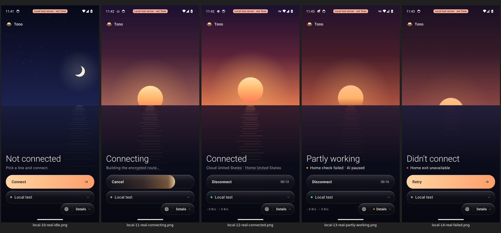
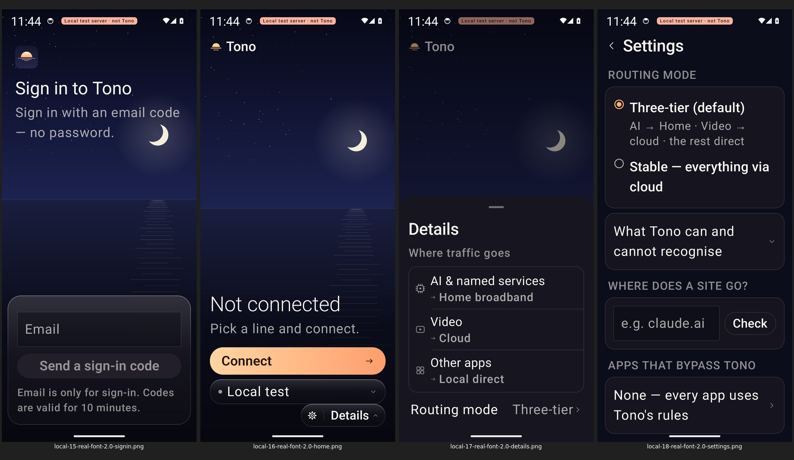
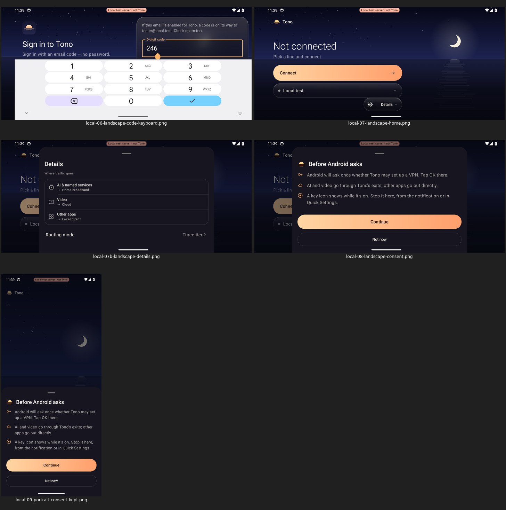

# PR 1673 · 第 7 轮独立审查

审查对象：raydocs/tono PR 1673；日期：2026-10-19 UTC。本人在本线程完成源码、原始 CI、图片及视频帧审阅，没有调用其他评审、子代理或线程，没有联系实施方，没有修改产品、提交、推送或向 GitHub 写入。

**结论：81/100，不通过；未达到原 rubric 的 85 分门槛，也未达到用户的 95 分目标；真实性性能 3/5 低于该项 70% 门槛。严重状态误导否决保留。** 前台引擎死亡修复有本 head 的执行证据，但 UI 进程不在、引擎死亡且 Android 不重启时，Connected 通知仍无独立失效路径。该后台组合在当前 head 未实跑，不能写成已复现，更不能因 CI 绿色写成已解决。

## 1. 固定对象和盲审边界

- 完整 head：`c18daa3db114fb059e1190e6e0e7aa7635f715b9`。先用 `git rev-parse c18daa3db^{commit}` 解析，再核对 PR API、run API 和各 artifact 的 `workflow_run.head_sha`，一致。
- PR head 分支：`feat/android-singbox-horizon`；API 所示 base：`59082acfb52f31963b39e52595549875d0f01ed4`。审查不随之后的分支移动改变。
- 原始 CI：[39176556620](https://github.com/raydocs/tono/actions/runs/39176556620)，run attempt 1，success；创建 2026-10-18 23:26:56Z，结束更新 23:46:39Z。
- 只读了允许的证据评论 [6256737598](https://github.com/raydocs/tono/pull/1673#issuecomment-6256737598)，把其中陈述当待核验主张，不把它当执行证明。图像取自原始 artifact，不使用评论中的加工图替代原图。
- rubric 文件仅为提取指定标准而读取；没有读取其他 agent-reports 报告、其他 PR 评论、实施/评审线程或密封自评。
- **盲性污染披露：首次提取 rubric 整节时，意外看到了该节来源说明中的 iOS 旧自评分“91/100”。** 这是一次真实的越界曝光，已披露；没有看到 Android 旧分数，没有用该数值评分。故不能声称完全零旧分数曝光。
- 另读取旧 run 39170392763 的元数据及原始 tunnel artifact 12153665259，仅核验系统曾保留死引擎通知的事实；它的 head 为 `ae2a2eb36f5ad518f9ea21346815f0a5c68d1d80`，不能作为当前 head 后台复现。其他列出的旧 runs 没有另行下载验证，其归因不背书。
- 使用固定源码中的 Android、CI workflow，以及少量桌面 SeaScene/控件与服务端 catalog 源码；没有运行修改版产品、生成新 CI 或新模拟器测试。桌面对照仅限源码，不宣称亲眼验证了桌面运行效果。

### 原 rubric，不另设标准

> 统一100分：信息层级减字20、交互连贯单手20、高级克制及最新桌面品牌一致15、Liquid Glass材质15、状态动效15、可访问性适配10、真实性性能5；>=85且各项>=70%，严重状态误导/主操作难发现/不可读一票否决。

提取的通过条件：总分 ≥85 且每项 ≥70%；严重状态误导、主操作难发现、不可读一票否决。95 是用户目标，不替换 85 的原始通过线。

## 2. 七维评分

| 维度 | 得分 | 70% 最低分 | 判断及扣分依据 |
|---|---:|---:|---|
| 信息层级减字 | **18/20** | 14 | 首页状态 → 一句解释 → 主操作 → 线路 → Details 的层级清楚；五态均有短词，不靠天空颜色独自表达。Details/Settings 承担解释而非首页堆字。扣分在错误原因过度归因：一般目录失败显示 Home exit unavailable；连接后的极小流量文字在视觉层级中非常弱。未见主要文字不可读。 |
| 交互连贯单手 | **18/20** | 14 | Connect/Cancel/Disconnect/Retry 在同一拇指区，主操作明显；真实授权与登录、本地隧道、Details、横屏和返回均有执行证据。扣分在真实默认动效下的交互矩阵不完整、返回“第一帧”承诺证据弱于表述；不把自动点击等同真实手持可达性测量。 |
| 高级克制及最新桌面品牌一致 | **12/15** | 10.5 | 日/月、墨色海面、暖色主操作、细字标题和胶囊语汇一致，留白克制。实际图像的反射是一列稀疏直线，海面较平、地平线切割明显；桌面固定源码有近远 glints/ripple、grain、Metal 水面与流量 sparkle，Android 的视觉完成度还未同档。源码差异只说明实现差别，扣分来自 Android 原图的简化观感；没有凭未运行桌面打比较满分。 |
| Liquid Glass 材质 | **11/15** | 10.5 | 不是假称 blur：u4 条纹对照和 Glass.kt 证明真实采样背景并 RenderEffect 模糊，暗色 tint、顶部高光、边缘均可见。但原始首页图仍更多读成烟色亮边胶囊，开放面板更近不透明深色卡片，材质对背景和层次的响应不够有说服力。API34 单一软件 GPU 图不能证明真机光学质感。不是以“必须复制某 OS 实现”作为新增门槛。 |
| 状态动效 | **11/15** | 10.5 | t3 真实状态转移与天空亮度关系、u8 设计时钟帧、a5 Remove animations 都成立；连接/部分可用/失败没有混成同一个状态。帧中有短暂文字淡出至很弱的过渡，真实视频稀疏，不能判定手机实时顺滑；更重要的是后台 Connected 通知存在无界失效缺口，不能给高状态可信度分。该严重缺口另触发原 rubric 否决，不用其他维度分数抵消。 |
| 可访问性适配 | **8/10** | 7 | 200% 系统字号真实 MainActivity、横屏软键盘与 consent 保留、中文/小屏/焦点/语义检查是有效正面证据。扣分在 TalkBack 没有实际听读、200% 真实五态未全覆盖，且截断/标签/cutout checker 有明确盲区。没有发现达到不可读否决的静态画面。 |
| 真实性性能 | **3/5** | 3.5 | 真实 APK、系统 consent、libbox、VPN network、出口日志证明并非全用 fixture 冒充。性能证据却不能证明真机帧率、耗电和流畅性：软件 GPU 录像平均约 2.58 个编码帧/秒，gfxinfo 样本 0 帧，u8 是设计时钟；真实账号/服务未测。3 分是对已证实范围给分，不把未知性能默认为优秀。 |
| **合计** | **81/100** | **总分 ≥85** | 总分与第七维均不通过，95 目标未达；否决独立成立。 |

三个否决项分别判断：**严重状态误导：是（条件明确的源码缺口，当前 head 后台未复现）；主操作难发现：未发现；不可读：未发现。** 后两项是对所见状态/尺寸的判断，不是所有设备的全称保证。

## 3. 原始 CI 的真实执行计数

| shard / 检查 | 原始证据 | 独立结论 |
|---|---|---|
| ui | artifact 12155260564：12 个 instrument 文件，均 `OK (1 test)`；summary 12 PASS；retry 跳过 | **首次 12/12**，u1–u9、l1–l3。 |
| tunnel | artifact 12155056933：7 个 instrument 文件，均 `OK (1 test)`；summary 8 PASS，其中 1 行为 host routing check；retry 跳过 | **首次设备测试 7/7，加出口核对 1/1**。b1–b3 是 3 项、t1–t4 是 4 项，不是 8 个设备测试再加分流。 |
| system 首轮 | artifact 12155007330 内 `evidence-attempt-1792366741/`：8 PASS、s1 FAIL；原始断言 `tile subtitle shows the shared status ("Sign in")` | **首轮 8/9**，不能称首次全绿。 |
| system 重试 | 同 artifact 的 `evidence/`：9 instrument 均 OK；summary FLAKY；日志与 API 证明 fresh-emulator retry、flaky 标记执行 | **重试 9/9，FLAKY 保留**。run attempt 1 与 job 内重试是两个概念。 |
| 设备合计 | 12 + 7 + 9 | **28 个设备测试最终全过**。加 host 出口核对共 29 个检查。评论的“29/29 设备，另加分流”多算一项。 |
| JVM mobile | 原始 HTML index：46 tests / 0 failures / 17 skipped | **46 是发现数，实际执行 29**。ScreenshotRender 15 与 MotionPreview 2 被跳过，不能说 46 个实际运行。 |
| JVM routing | 原始 HTML index：16 tests / 0 failures / 0 skipped | **16 个执行、0 失败**。两模块合计发现 62、执行 45、跳过 17、0 失败。 |

首轮 s1 的 `real-tile.txt` 为 shared status SIGNED_OUT、description `Tono, Sign in`、subtitle false；诊断图显示紧凑 QS 行，三次重开仍如此。重试显示完整磁贴、副标题 true。支持“共享状态正确但面板展开/查找失败”的解释，不支持把它说成产品误报 Connected；也不支持删除首轮失败。

注意 workflow 首次 emulator step 使用 `continue-on-error: true`。GitHub jobs API 的该 step conclusion 被处理成 success，**不能只看该绿色判断首轮通过**；本结论以原 instrument 失败、首轮 summary、重试日志及 FLAKY 为准。

## 4. 七项验收映射：成立的范围及限制

| 原验收项 | 固定源码及原始执行 | 结论与边界 |
|---|---|---|
| a1 登录/本地校验 | DeviceEvidenceTest.kt:89–101；system instrument-a1、real-01/02 | 真实 MainActivity 渲染并输入非法邮箱；只是客户端校验，不是服务登录。 |
| a2 系统 VPN consent | 同文件:115–140；system instrument-a2、real-03/04 | 真正 `com.android.vpndialogs`，Android 记录授权。但由测试在未登录 MainActivity 上直接 `startActivityForResult(prepare,1)`，不是普通用户从 Connect 走完前置流程；完整普通流程由 t1 补充。 |
| a3 无账号拒绝连接 | 同文件:150–164；system instrument-a3、real-05 | 向真实服务发送 connect，检查无 VPN network、仍为登录页；没有 fixture 接管 UI。 |
| a4 ABI/配置 | 同文件:167–175；real-core.txt、instrument-a4 | 真 libbox 1.15.0-alpha.12 / x86_64 checkConfig 接受 THREE_TIER、STABLE；**引擎级、无界面**，不能概括为四项都验证了 MainActivity 用户流程。 |
| b1 → t3 五态 | LocalTunnelDeviceTest.kt:624–684；instrument-t3、local-10…14 | 真 MainActivity + 本地替身 control plane/出口 + 真引擎。normal 接通且 VPN network 在；home-down 返回 Partly working/短因且 VPN 在；catalog-unavailable 返回 Didn't connect/Retry 且 VPN 不在。已从原始图看过全部五态。 |
| b2 → t3 动效/天空 | 同文件:554–562、670–675；原始 local-real-motion.mp4；四态 PNG | 真应用录屏和亮度差成立，不把 fixture b2 当真实 t3，也不把软件录像认作 60fps。独立重算见下。 |
| b3 → t4 系统 200% 字号 | 同文件:697–765；instrument-t4、local-15…18、real-font-2.0-report | 实际 `settings put system font_scale 2.0`，真 MainActivity；登录、验证码、idle Home、Details、Settings 走过语义/布局检查。四张截图不含验证码截图，但源码中的该步断言确实执行。未覆盖 200% 下全部连接状态、所有页面或 TalkBack 发声。 |

保留的 b1–b3 均明确在 fixture host，图名 `fixture-` 且图上有 FIXTURE 标记；只能补充设计表现。t1–t4 则使用 `ActivityScenario.launch(MainActivity::class.java)`，本地替身选择只改服务 API/出口，真实引擎、真实 TUN 与状态流仍运行。`Local test server · not Tono` 在真实本地流程可见；不能称真实 Tono 服务已验收。

### 天空亮度复算

直接解码原始 PNG，以源码所定屏高 8%–45%、横纵步长 6 像素、RGB 权重 0.2126/0.7152/0.0722 重新计算，每张 26,640 个采样点：

| 状态 | 本次重算 0–255 | CI 留存四舍五入 |
|---|---:|---:|
| Not connected | 27.314456 | 27.3 |
| Connected | 80.920444 | 80.9 |
| Partly working | 63.128910 | 63.1 |
| Didn't connect | 48.624466 | 48.6 |

Connected 比 idle 亮 53.606；partial 比 idle 亮 35.814 且比 connected 暗 17.792；failed 比 idle 亮 21.310 且比 connected 暗 32.296。满足原断言。**亮度顺序证明状态场景切换，不自动证明玻璃高级、文本对比度或动效顺滑。**

## 5. t1：前台修复有执行证据，不能外推后台

固定源码 `LocalTunnelDeviceTest.kt:123–165` 在 Connected 且 MainActivity 在前台时，对真正的 `:vpn` PID 调用 `Process.killProcess`。循环最多 90 秒，采样 VPN transport、Home 文本、共享 SurfaceRules、通知标题；Home/通知允许 1.5 秒重绘宽限，重连后立即结束循环。

原始 `logcat-live.txt` 时间线：

1. 23:40:26.429：PID 7232 发送 SIG9。
2. 23:40:26.507：VPN `state=DISCONNECTED`，随后 dead process、network disconnected。
3. 23:40:29.537：新 `:vpn` PID 7479 启动。
4. 23:40:32.276：VPN 重新建立，约杀进程后 5.85 秒。

`instrument-t1` 为 OK；local-04b 原图为 Status unknown，local-04c 为 Connected。由源码、执行成功、日志、截图相互印证，**该前台故障注入确实执行并通过**。但不是“完整连续观察了 90 秒”：90 秒是上限，这轮在恢复时提前退出。

随后 `backFromHomeScreen`（172–190）pressHome、等待、am start 返回同一 Activity，再查询 Connected/unknown，断言 VPN 在且查询期间未见 unknown；它与前面的 kill 是顺序分开的两个场景。**没有在后台 kill、没有移除 UI 进程，也没有录下前台返回的第一帧**；am start 完成后才开始查询，早期短闪可能漏过。不能据此称“首帧绝不闪未知”或“后台死亡已测”。

关于 QS/Widget：t1 检查的是 `SurfaceRules.view(...)` 的结果，不是已安装的 Connected QS/Widget 实际像素更新。s1/s2 在系统 host 验证的是未登录入口；s3 是 fixture。因此“共享规则不谎报”与“所有系统表面在死亡后立即刷新”必须区分。

关于出口：原始 exits.log 确实有 cloud-in→www.youtube.com、home-in→api.anthropic.com / claude.ai、cloud-in→198.20.0.11:21080；example.com 返回 HTTP200 且两个出口未见。支持本地拓扑的分类/链路核对。HTTP302/404 是请求有响应及路由事实，不是视频播放/真实 AI 服务功能验收；也不是死亡/失效期间的持续抓包泄漏检测。

## 6. F1 · 严重状态误导残余：有条件的源码确认，当前 head 后台未复现

**条件：UI 已退出或 UI 进程不在 → 引擎仍曾连接 → 引擎进程死亡 → Android 保留 FGS 通知且未重启服务。结果：通知可持续显示 Connected，而隧道已消失。** “关闭”在这里不是保证清掉所有通知和服务的 `am force-stop`；也不是只把仍活着的 UI 暂时放后台。

固定源码链条：

- `ui/MainActivity.kt:90–96`：EngineModel 建立 EngineClient 绑定；onCleared 解绑。UI 进程不存在时没有该实例/回调。
- `ui/EngineClient.kt:85–97`：仅 ServiceConnection.onServiceDisconnected 中调用 `TonoNotifications.replaceAfterEngineLoss`；复活 runnable 在 68–73，要求 bound 且非 paused。
- `engine/TonoNotifications.kt:19–54`：Connected 标题来自 snapshot；常驻通知没有 `setTimeoutAfter` 或其它到期语义。87–93 的替换函数需要别的活进程调用。
- `engine/TonoVpnService.kt:105–120`：START_STICKY 请求系统重启，但没有限时保证；死去的引擎自己不可能更新/撤销通知。
- `surface/SystemSurfaces.kt:35–37`、`TonoWidget.kt:34–40,80–86`：Widget/QS 刷新路径不替换 notification，不能填补通知空缺。

对“Android 可能保留通知且不重启”的支持：允许读取的旧 run 39170392763 原 instrument-t1 从 1813ms 到 89864ms 反复记录 `notification says Connected without a VPN network`。这是真实旧 head 前台证据；本 head 新增前台替换成功，说明并非所有失败仍在。但后台没有该观察者时，修复路径不执行。允许的评论也坦承同一残余，**结论不是只复述评论，而是独立追过源码存活条件与通知构造**。

为何属于否决而非一般小问题：通知本来就是无需打开应用的常用隧道状态入口；在 VPN 不存在时无限期保留肯定的 Connected，会改变用户关于保护状态的决策。更严格的当前证据说法是“无法界定何时结束、条件成立时误导仍可达”，而非“本 head 每次后台死亡都必现”。没有本 head 后台注入，概率与机型分布未知，不能伪造复现视频。**不以未知发生率豁免严重状态误导，也不宣称已证明流量泄漏。**

Widget 的额外限制：SurfaceRules 的 heartbeat 30 秒、stale 90 秒是读时判断；TonoWidget 使用 `AlarmManager.set(ELAPSED_REALTIME, now + 90s + 10s)`，为 inexact、non-waking。约 100 秒是调度目标，**不是最长 100 秒的严格上界**；之前已经画到 launcher 的 Connected 仍依赖下一次实际 refresh 才改变。QS 在重新监听时检查，比“时刻自动正确”弱。此处没有新增注入，不夸成已见误报。

## 7. t2、字号与测试条件的合理部分和缺口

### t2 真实横屏、软键盘、consent

`LocalTunnelDeviceTest.kt:450–526` 在真实 MainActivity 输入验证码 246、强制显示硬键盘环境下的软键盘、转横屏；断言 IME 可见、字段底边不超过键盘顶边、输入保留。原图 local-06 可见 246 和数键盘；local-07/07b 可见 Home/Details；local-08 是 Tono 授权说明，local-09 转竖屏仍保留。**该 consent 指 Tono 的前置说明面板，不是系统 VPN dialog 自己的转屏保留。**

排除全窗口 scrim 合理：一个有 Close sheet 语义、覆盖全屏的 dismiss 区不是需要避开摄像头的正文/按钮，直接把它算命中会产生假失败。但 `underCutout`（428–440）实际按宽高排除任意全窗口节点，未核验它就是 scrim；还排除 local mark，只遍历有 text/description 的节点，且未断言 cutout rect 非空、未把实际 rect 写入证据。**范围比口头的“仅排除 scrim”宽，可产生空集通过；静态图和当前断言只支持这次 Home/Details，没有全页面/所有 cutout 的覆盖保证。** 这是有边界的测试过滤，不是已经证明产品内容压孔，也不是充分证据说明蓄意规避断言。

### Remove animations

workflow 290–300 与各 `animations.txt` 一致：非动效测试 animator_duration_scale=0；a5、b2、u8、t3 为 1，a5/t3 先静止启动再开。对软件 GPU 下静态布局、语义、路由行为隔离动画等待是合理的；默认启用动画下的时序/点击/旋转并未因此自动获得同等覆盖。t3 真实连接状态的动效仍开启，避免了完全只靠 fixture 的缺口；不能据此说所有默认启动、前后台和授权交互也都测过动效。

### 开测环境 gate 1000ms

固定 workflow 218–236 明确 gate 为 1000ms；当前 ui=300、tunnel=850、system 首轮750/重试850，均通过该准入。源码注释也记载了从 775 放宽到 1000 的原因；**这是环境准入的放宽，不能绝对说没有任何阈值变化。** 它不修改 t3 亮度差、t1 无假 Connected、布局等产品断言，不能等同降低这些验收线。

准入条件由本次已见最慢环境值决定，仅适合解释“允许继续功能测试”，不是交互速度达标依据。unknown median 也不会被该 gate 拒绝。没有读取旧源码去证明全部断言历史未变，故对“没有放宽任何断言”不作全称认证。录像和性能数据应另行标注慢环境，而非拿 gate 通过加性能分。

### 字号/可访问性 checker

`A11yContract.kt:21–65` 对有点击语义的节点检查布局尺寸，完整可见节点还查 touch bounds；文本检查 ellipsis、maxLines、height overflow。有效但不全：不查 didOverflowWidth、不查祖先/窗口裁剪对文字的影响；roleless 且无标签的 actionable 不报错，partly scrolled 节点不校验最终触达尺寸。报告的“每个控件有标签、无截断”比 checker 能证明的范围大。

200% 原图主要正文和 Connect 可读；Details 需滚动，不是“所有内容一屏显示”。中文、小屏、横屏的 fixture 图也已查看，未见不可读否决，但语义顺序测试不等于 TalkBack 实际朗读、探索顺序或动态状态播报可用。没有真机/听读证据，不记为已证实。

## 8. 视觉、动效与性能证据分别能说明什么

- **视觉：** 本人查看了 65 张最终 PNG 的联系表（real14/local22/fixture29），以及首轮 s1 诊断图；五态、登录、Details/Settings、系统表面、中文、小屏、横屏和 200% 均纳入观察。联系表只做缩放/排版，没有修改产品图。当前实际画面支持层级/主操作的高分，不支持以测试数量代替材质审美判断。
- **真实录屏：** 原始 t3 mp4 1080×2400，时长 171.980467 秒，444 个编码帧，平均约 2.58 帧/秒。查看了完整时轴抽样及全部 444 个原始帧的 dock 区联系表（10 页、附原 PTS）；可以核对状态/文案/操作位置变化，**不能证明真机 60fps，也不能把编码帧率直接当产品实际 display FPS**。软件 GPU 录像的长等待不能直接归罪为真机产品卡顿。
- **设计时钟：** u8 明确 `mainClock.autoAdvance=false`、逐帧推进，392 张半尺寸 JPG、标称 16ms；通过断言仅 frame>380。它有助于看转场形态/文字淡入淡出，但没有逐帧状态真假或实时性能断言，也不是 392 个独立测试。抽查关键状态切换帧后可见暂时淡出的文字，不把短暂转场淡化夸成持续不可读否决。
- **玻璃：** u4 条纹实验 bare162.5、Tono glass0.1、同 tint 无 blur83.2，支持模糊实际作用；Glass.kt 共享 backdrop、局部 blur 与高光符合源码。该实验不能独自证明 Liquid Glass 的高级质感或所有手机 GPU 表现，按原图观感评分。
- **性能：** system/perf.txt 五次 TotalTime 1442–1866ms；同文件 `Total frames rendered: 0`、percentiles4950ms，无有效帧样本。0 janky 不能解释为完美流畅。health 的帧时和这些 gfxinfo 的空样本不能混成性能合格证明。APK 65,072,711 bytes；大小是测量，不是速度/能耗结论。
- **错误原因小缺陷：** `TonoVpnService.errorCode` 705 行把所有 CATALOG_UNAVAILABLE 映射为 HOME_UNAVAILABLE，原图 failed 也显示 Home exit unavailable；固定服务端 catalog-yaml.ts:157,199 的通用目录错误并不特指 Home。应保持失败提示的正确归因，但这里始终 Didn't connect/Retry，不是该项严重保护状态否决。

## 9. 已证实、源码结论、未证实

**已证实执行：** 固定 APK 与原始 run 对齐；ui 首次12、tunnel 首次7+路由核对1；system 失败保留后9重试过；JVM发现数/跳过数；真实本地 MainActivity 五态、亮度关系、200% 字号范围、横屏键盘/前置 consent；前台引擎 SIG9 后未知→重连；少量分类路由出口匹配。

**视觉判断：** 主操作明显、主要文字可读、暗亮层级清楚；海面/反射、材质完成度距离 95 目标仍明显，不因 CI 绿而补分。评分有审美判断成分，证据图与具体扣分依据一并保留。

**源码条件结论：** UI 不在时通知替换缺观察者；Widget 100s 不是严格上限；cutout/a11y checker 的证明边界；通用目录失败过度归因。明确不冒充当前 head 运行观察。

**未证实且不加分：** 真机 GPU、实时流畅度、触感、耗电；真实账号/真实 Tono 服务/真实 Home 分配；TalkBack 听读；后台双进程故障与不重启组合；所有设备、所有系统表面立即一致、持续无泄漏、真实站点功能可用、全部失败路径。没有注入/抓包，**不称泄漏**。

## 10. 交付和复核入口

- 完整证据说明：`EVIDENCE.md`；逐文件/ZIP 成员证据索引：`EVIDENCE.tsv`。
- 原始下载物：`raw/`；固定源码快照：`source/`；原始关键图片/视频及联系表：`visuals/`；重算结果：`receipts/independent-recompute.txt`。
- `SHA256SUMS` 校验本目录全部交付文件（不含自身），包括报告、清单、原 ZIP、源码、重算回执和视觉附件。完整报告与证据说明的 SHA256 另在最终回复给出，避免自引用 hash。
- 没有产品改动、commit、push、PR 评论或发布动作。这里只交付审查结果；本结论不能当发布验收。
