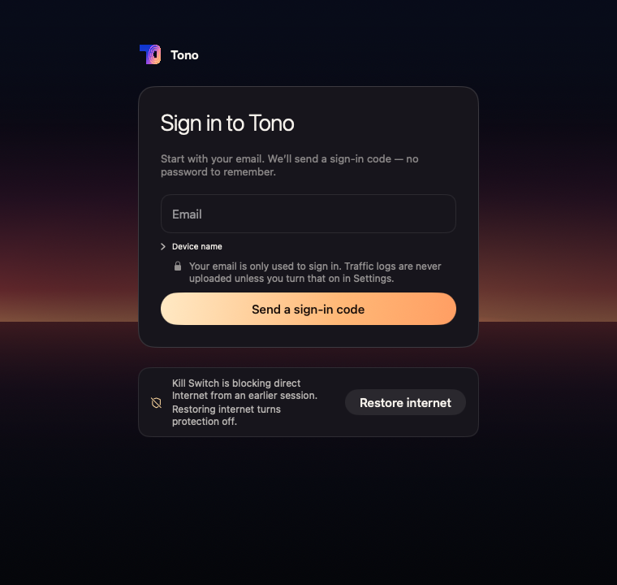

# Tono 国内 Windows/macOS 付费上线有限审计 · 2026-10-10

**结论：界面已经不宜笼统打成旧的 6 分；公开付费上线就绪度仍约 6–7 分，当前不放行。**
缺的主要是一个可信、可安装、可恢复、可支持的最终候选及现场证据，而不是照着 Proton 增加功能。
可以继续内部验收；有限付费试运营也须先过下面的最短清单，不能把「人数少」当作隐私或网络保护的豁免。

归属：[SHIP_PLAN](../SHIP_PLAN.md) G1/G2/G3/G4；运维现状参考 [ops plan](../ops/plan-2026-09-11.md)，
不把整个 ops backlog 变成 0.0.75 发布门。此报告是独立判断，不代替老板勾选 G1/G2，不改 G3 的延期决定。

## 1. 审计对象是远端源码，不是当前客户安装包

- 核实基线：[origin/main `a6ef4580fe3a890338ad2f9a1ae786c3318c31a0`](https://github.com/raydocs/tono/commit/a6ef4580fe3a890338ad2f9a1ae786c3318c31a0)，
  GitHub commit 时间 2026-10-10 23:25:33Z。状态核对截止 **23:35Z（Denver 17:35 MDT）**。
  本审计 orb 的 local main 与它相同；协调线程的 local main 在 `2f4b2c19`，不能作为当前版本。
- [协调线程](https://ampcode.com/threads/T-01a12506-8674-77da-a956-c31ff53add43)、
  [Sol reviewer](https://ampcode.com/threads/T-01a126c1-8b2b-741f-b212-3669beb1724d)、
  [组合验收](https://ampcode.com/threads/T-01a12708-4574-7044-82b6-441016c0e1ee) 均已读；线程历史有滞后，以下以 GitHub PR 回执和源码为准。
- **尚未冻结，没有本次最终候选、签名/安装证据或包哈希。** 协调顺序：A13 → Windows 登录 UI → 隐私告知修复 → records → 冻结 SHA →
  组合验收 → 两端候选（计划序列 7506、Mac DMG）。这是计划，不是已完成的交付。
- 仓库客户 feed 仍为 Mac Sparkle **0.0.67/build 67**、Windows **0.0.34**；GitHub v0.0.75 为 Draft。
  [G1/G2 勾选](../SHIP_PLAN.md#6-整体验收过发布标准的检查表) 全未完成。旧候选不包含本轮修复，不可用它证明本轮质量。
- 只读源代码/Issue/PR/现有日志和截图；没有实现、构建或重跑产品测试，没有新子线程，没有生产查询写入、部署或发布。
  唯一外部新增是本次确认的隐私告知 Issue [#1556](https://github.com/raydocs/tono/issues/1556) 与独立 docs PR。
- **23:38Z 续记，仅待合状态：** 主线程确认隐私问题也存在于 Windows，已开 [#1557](https://github.com/raydocs/tono/pull/1557)
  @d0cae8f479543881461378cc159577e61aa33d5d，统一发现 ID **LOGIN-LOG-UPLOAD-COPY**、in-PR；两端中英文 copy-only，默认不变。
  主线程报 Windows login.test 本地14/14、CI pending，尚未重拍修后图；合并顺序在 #1554 之后。
  本报告不复制其改动或重复新建分片，不把待合修复算已在审计基线上完成。
- **23:41Z 交付前复核：** origin/main 未变；#1504 @6a51868d 的 ci-gate 已 SUCCESS，但仍无该 head 的 Sol 回执。
  #1554 @5ae3fdec 已有[协调者视觉 PASS / 1 minor](https://github.com/raydocs/tono/pull/1554#issuecomment-6103375412)，尚无 Sol 完成回执；
  该视觉项不是原生 Windows 验收。#1557 推进至 @dc9bdb3b56a5899700f2846375bb3861f0899a80，CI 运行中，仍 OPEN。
  后续章节保留23:35Z快照；上述进展均未进入本报告审计 main，不改变当前上线判断。

## 2. 分数是证据约束的判断区间，不是测试成功率

10 分意味着客户路径一致、重要失败可恢复、实际交付和现场证据覆盖目标使用范围；不是功能数量。
分数不取平均来抵消阻塞，也不预测未执行的真机结果。

| 维度 | 当前区间 / 置信度 | 给分与扣分依据 |
|---|---|---|
| UI 视觉 | **7.5–8.2 / 中** | 实看海景首页、两端设置、错误/托盘；层级与品牌已经成形。Windows 是 Chromium 合成 IO，Mac 有 hosted AppKit 窗口；未验真实 Windows 字体/DPI/屏幕阅读器，不能给 9 分 |
| UI 交互与一致性 | **6.5–7.4 / 中偏低** | 保存回执、未知状态和键盘恢复有代码/DOM 证据；#1554 尚未合，首登隐私说明错误，Windows 与 Mac 切语言的成本不同，原生焦点/IME/读屏未验 |
| 连接与恢复 | **6.0–7.0 / 低** | relay-only、取消/看门狗已有修复/回归；没有最终组合、国内家宽、真实掉线/睡眠/解除证据，A13 最后出口仍未闭合 |
| 安全与隐私 | **6.5–7.5 / 源码中、现场低** | PF/WFP、身份门、TLS 和更新签名/序号防回放不是空壳；A29/#1542/relay 竞态已修。#1071、首登告知、既有 trust 边界及现场保护验收仍有限制 |
| 交付与运维 | **6.0–7.0 / 中偏低** | 有 CI、发布规程、D1 导出记录、诊断/邮件/节点验收能力；最终包、恢复实练、容量余量、真正收到告警、退款支持闭环均未形成此次上线证据 |

**整体公开付费上线就绪度：6–7，置信度中偏低；「已足够公开卖」不成立。**
「界面仍只有 6 分」也不成立。有限试运营是可达目标，但仍是下面条件满足后的判断，不给未完成工作预支分数。

## 3. 已修的不能再当作当前 FAIL

| 项 | 当前事实与证据 | 尚未证明什么 |
|---|---|---|
| A29 / #1506 | 已合 [dfb06df7](https://github.com/raydocs/tono/commit/dfb06df79551653992d6793348f33c59c32d10b9)，Sol PASS head [7255b59b](https://github.com/raydocs/tono/commit/7255b59b8891281e0ae2f2139499b3389418b9c3)，[CI 38089611039](https://github.com/raydocs/tono/actions/runs/38089611039)：707 XCTest / 1 skipped / 0 failed。LAN 开关默认关；held/unknown protected fault 下自动升级不释放 PF、不删 DNS 快照，显式 Disconnect/Restore 保留 | 真实 PF/LAN/DNS、睡眠、旧 helper 升级故障 |
| #1542 | 已合 [5865ce73](https://github.com/raydocs/tono/commit/5865ce73c6ea4f1d5b63a4b58ed32cfd188efa69)，head [90431f60](https://github.com/raydocs/tono/commit/90431f6080cc90f2b334280ed5c668d324c4dade)，[CI 38087835990](https://github.com/raydocs/tono/actions/runs/38087835990) 绿；networksetup fallback 的 15s deadline 从启动前计，过期命令不得迟到启动 | 真实 System Configuration 争用、pfctl/networksetup 卡住；没有替 A13 所有应急路径加期限 |
| #1553 / #1555 | 已合 [62bab6ed](https://github.com/raydocs/tono/commit/62bab6ed59941026da280d02598682ccd623a4cf) / 审计基线。精确 [#1553 PASS](https://github.com/raydocs/tono/pull/1553#issuecomment-6103147944) @f5e91755：0 major/1 minor；[#1555 PASS](https://github.com/raydocs/tono/pull/1555#issuecomment-6103295398) @425f6dcb：0/0，关闭 M2 | 不等于 Windows 实际 WFP 或国内 relay-only 登录成功。旧 @4a4b7c95/@636ce742 FAIL 已失效 |
| Windows watchdog / #1549 | 已合 [b9c6e4d2](https://github.com/raydocs/tono/commit/b9c6e4d2f7aba10b6c8f426186184065137e5f8e)，审阅 head [46423bdb](https://github.com/raydocs/tono/commit/46423bdbafb8263113bcb5cfdfd50d7cb69550ee)，[CI 38081807721](https://github.com/raydocs/tono/actions/runs/38081807721) 绿；不能再按 reviewer 较早记录称它 Draft | 真实 Core/Job/SCM 故障恢复 |
| 设置、托盘与 Mac relay-only | #1546/#1550 设置与托盘归档已在 main；Mac `TonoAPIClient.exchangeOverPaths` 同样无隧道时 relay-only，途中失去隧道丢弃后续直连步骤 | 不证明所有 UI 原生时序、所有旧 Service/helper 兼容分支或真实上传关闭都通过 |

### 尚未合入的准确状态

- **A13 #1504**：head [6a51868dca9e111b526d247ebbb32767cca209d8](https://github.com/raydocs/tono/commit/6a51868dca9e111b526d247ebbb32767cca209d8)，
  合了 #1542/A29，helper 4.52.50；截止时 CI 未结束，**没有该 head 的 Sol 判决**。
  [round-5 FAIL](https://github.com/raydocs/tono/pull/1504#issuecomment-6102609122) 的 4 major/1 minor 仅适用于旧 @7e2ef0e7，不能套到它。
  main 未包含 A13，`UpdateStorage.locked` 与 `UpdatePackage.run` 的应急无界等待仍在。
- **#1554 Windows 登录 UI**：head [5ae3fdece99496e0f10019adada34250ead7f345](https://github.com/raydocs/tono/commit/5ae3fdece99496e0f10019adada34250ead7f345)，
  OPEN，截止时已 non-draft、[CI 38094835344](https://github.com/raydocs/tono/actions/runs/38094835344) gate SUCCESS；尚需精确 head Sol 回执和协调者视觉验收，不能当 main 已交付。
  [#1478](https://github.com/raydocs/tono/pull/1478) 的 full-walk Paths tried/逐路径耗时并未被它全部替代；不把更详细耗时列表当付费必需新功能。

## 4. 真正仍开放的上线阻塞

| 阻塞 | 为什么挡住公开付费上线 | 最短关闭方式 / 谁 |
|---|---|---|
| **B1 候选与现场资格为空** | 没有最终 SHA/包哈希，更没有国内首登、实际出口、DNS/IPv6、取消/掉线与显式解除的组合证据；只看单 PR 绿不能保证付钱后能用 | 协调者冻结/构建；老板或授权测试者在同一候选的 Win11/Mac + CN 家宽执行 §7；老板记 G1/G2 |
| **B2 应急恢复 / A13 未闭合** | main 已知的最后出口无界等待可让断网用户无法恢复；不能称「任何故障都能恢复」。只是排除 PR 不会排除 main 上的问题 | 当前 #1504 实现者完成新 head、独立 Sol 精确覆盖、CI；Mac 操作者做在线 daemon、锁占用、超时下恢复实练 |
| **B3 #1071 只被 A29 部分改善** | `HelperManager.releaseAfterAbandonedUpgrade` 在 fresh fault=false 时仍 restoreDNS + disarm，清掉 AI hold。A29 只保护 held/unknown 分支，不能关整个 #1071 | 主线程处理 legacy-compatible release 契约并复验；或试运营明确只收已验 clean install/当前 helper，不宣称覆盖旧 helper 升级。公开升级用户不能这样排除 |
| **B4 LOGIN-LOG-UPLOAD-COPY：#1556 / #1557** | 两端首登中英文说「除非你在设置打开，否则不会上传」，新装开关却为 true，服务端按决定076接收主机名/进程路径。是确认的产品告知错误，不是观测到的凭据泄漏 | #1557 copy-only修复 in-PR；精确 head 渲染；最终安装验证默认、关闭、账户切换和在途上传边界 |
| **B5 面向收费的支持与恢复责任未证实** | 有退款账目和销户能力，不等于已退真钱、通知客户/撤权限成功；有备份工具和告警，不等于有人收到、数据能恢复 | 老板指定联系渠道、退款/补偿规则与值班人；运维提供实收告警、备份校验/隔离恢复、在售容量事实。小试运营可人工，不要求接支付平台 |

对 B3：[#1071](https://github.com/raydocs/tono/issues/1071) 仍 OPEN，源码事实见
[HelperManager.swift](../../apps/macos/Tono/Core/HelperManager.swift) 的 `cleanUpAbandonedUpgrade`、`releaseAfterAbandonedUpgrade`。
不能为了保住 AI hold 直接调用旧 helper 不支持的 `/killswitch/release`，否则会把普通网络留在全阻断。

### B4 的直接证据

```text
LoginView.swift:353
Traffic logs are never uploaded unless you turn that on in Settings.
Localizable.xcstrings:1129
流量日志不会上传，除非你在设置里打开。
AppSettings.swift:40
networkLogUploadDefault = true
```

`AccountSession+Telemetry.updateDiagnosticsLogUploading` 在 ready/已登录且该开关开启时启动上传；
不是登录前就上传。新装没有旧 opt-out 的场景足以反驳首登承诺；已有 false 仍保留。
Windows `locales/{en,zh}/tono.json:237` 的 `tono.login.trust` 同样如此。
规范发现分片由主线程在 [#1557](https://github.com/raydocs/tono/pull/1557/files) 维护；本报告不建立第二个 ID。
下面是原始 hosted 原生窗口字节，合成账户/状态，不是客户机器：



## 5. 能力已存在，但不能夸大覆盖范围

| 实际路径 | 源码/已交付事实 | 上线判断与证据缺口 |
|---|---|---|
| 首装/权限 | Mac DMG 首装引导源码已修，App 在 /Applications、Developer ID/helper 身份门存在；Win NSIS/Service 门禁有原因码和恢复入口 | final DMG Gatekeeper/公证/拖入与管理员拒绝、Win11 UAC/卸载/恢复未验。hosted Server UAC disabled 不替代 Win11 |
| 首登/relay-only | 两端生产 API 无健康隧道时只走 relay、TLS 保持真 hostname；POST/DELETE 仅在可证明未送达时换路径，防重复副作用 | 新 Windows Service 能报告 permit；旧 Service<20、unknown 和 Mac 旧 helper 有兼容例外。全 relay 不通必须明确报错、不自动解除保护；#1554 UI 配套未合 |
| 连接/取消/恢复 | 有 generation、取消/事务边界、同节点自愈/看门狗、明确 Restore/Disconnect；取消/恢复修复已经合入，不复用组合线程旧基线 FAIL | 真实断网、睡眠、服务重启、保护未知与“已解除”需要系统状态和实际请求的双重证据；截图不是网络测试 |
| 更新信任 | Mac helper `UpdatePackage` 固定 Ed25519 key；Win Service `verify_manifest_signature` 固定 build-time minisign key；两端要求序号大于 installed floor/consumed high-water，回滚不降高水位 | 哈希≠签名；签名算法存在≠本次包已签。G3 对0.0.75延期可披露，但不得承诺 protected auto-update已认证 |
| 更新失败/修复 | [#1307](https://github.com/raydocs/tono/issues/1307) 仍 OPEN：恢复耗尽后的 pending 混装记录使更新/安装/卸载门均拒绝，无已证支持修复出口 | 广泛升级用户的运维阻塞；有限 clean-install试运营可限定范围，但需证明所用手动恢复路径，不靠删除日记/降低高水位绕保护 |
| 账号/设备授权 | `accounts.ineligible` 检查 active/到期/quota；`evictDevicesOverLimit` 单 D1 batch 同账户撤 LRU 设备、session、exit credential；refund close 事务停账号/回收绑定并 enforce | 有权限实现，不是已完成收款→开通→退款→设备撤权现场闭环。双 OS 用户测试缺；#1291已fixed，不能仅因Issue open称仍会接管 |
| 既有授权边界 | [#1280](https://github.com/raydocs/tono/issues/1280) 的 Service DIRECT admission 做形状约束，不亲自验证全量 signed policy；[#1290](https://github.com/raydocs/tono/issues/1290) 第二 OS 用户误把他人屏障认作自己仍 open | 不应宣传Service独立认证所有DIRECT规则/多用户无缝接管；不是任意普通应用已被证明能绕过。限定单 OS 用户的试运营可披露；公开承诺按支持范围再验 |
| 策略防回放 | #317客户端/Worker嵌入revision和ratchet修复已记录fixed | 发布侧开关默认关，实际签名策略是否已采用新revision未核验；Issue OPEN不能等于源码未修，也不能等于生产已启用 |
| 支持诊断 | 支持报告有预览、显式发送、回执/支持码；自动结构化诊断与原始流量日志分开。服务端自由文本去password/UUID/email/IPv4，自动bundle不存任意logExcerpt | 不是“所有诊断全匿名”；正则不是对IPv6/家目录/任意秘密的全面证明。raw log明确含主机名/进程路径，不得混称“不含浏览痕迹” |
| 隐私/删除 | [决定076](../decisions/076-2026-10-08-raw-network-logs-stored-by-default.md)：raw14天、汇总90天；[R1455-grok-F1](../findings.d/R1455-grok-F1.md) 已记汇总不随删号删；结构化90天、AI route60天 | 仓库已披露不等于客户已知；老板需统一首登/设置/支持/隐私说明，不能宣传零日志或删号立即全删；法律合规不由此技术审计证明 |
| 账务/退款 | `ops/handlers/ledger.ts` 支持revenue/refund/credit与冲正；`shared-admin/catalog.ts` users/close处理refund标签与停权；[billing model](../ops/billing-model-proposal.md) 明确只登记/对账，不接支付平台 | 人工收款退款可做付费试运营，无须自动订阅新功能；未找到客户退款时限/争议渠道的执行证据，不等于业务上一定没有，须老板确认 |
| 告警/容量 | profile已有capacityUsers/failureDomain；节点acceptance对关键unknown/fail不标sellable；邮件有2026-10-05 sent/HTTP200记录 | 仅传输成功，非收件箱已收；当前在售占用、容量、峰值带宽/失败率未读生产证实。不能由字段存在推算可卖人数 |

### 运维不是空壳，也还不能证明规模化

- [控制面部署记录](../changelog.d/2026-10-10-control-plane-deploy-11441941.md) 证明此前导出、迁移预演和版本读回；
  **生产记录是 `114419412…`，不能把审计main `a6ef…` 当作已部署 Worker。** 后续中继E2E/告警源码合入不等于已部署/节点已装。
- 两个 DMIT + 一个 Arosscloud 中继已记录上线，另一 ASN 缓解同供应商问题；**三台仍同在洛杉矶，后端仍是Cloudflare**。
  relay-only 增加首登对这组中继的依赖，不是三条独立控制面。
- [api-relay runbook](../ops/api-relay.md) 明写E2E探针安装待做；第三台relay无exitNodeId，只有TCP-open判据。
  [恢复告警规则检查](../changelog.d/2026-10-10-relay-alert-rule-check.md) 只对fixture执行，生产规则/投递未验。
- [#208](https://github.com/raydocs/tono/issues/208) / D16仍记录自动D1备份缺owner提供的凭据；本审计未读secret或运行备份。
  已有部署前人工导出不可推成每天备份成功，也不证明隔离恢复可用。有限试运营可有明确责任人的人工备份；规模扩大前要补实证。
- [screenshots nightly 38089227621](https://github.com/raydocs/tono/actions/runs/38089227621) 真实为FAIL：ops 110 failed/235 passed/9 skipped，
  macos-window-captures SUCCESS。不能说所有视觉CI全绿；也不能用这份旧ops像素失败否定新relay代码或客户网络。

## 6. 实际看过的视觉证据与限制

| 实看内容 | 准确来源 | 能证明 / 不能证明 |
|---|---|---|
| Mac默认首页、最小Protected Offline、邮箱首登、支持预览 | [CI38090719777](https://github.com/raydocs/tono/actions/runs/38090719777) 的 [artifact11683498862](https://github.com/raydocs/tono/actions/runs/38090719777/artifacts/11683498862) @dfb06df7；下载只查看renders，`git diff dfb06df7..a6ef4580 -- apps/macos`为空 | **hosted AppKit真实窗口+合成产品状态**。默认页Connect/选线层级清楚；小窗Retry/Restore完整；首登隐私矛盾实际可见。不是签名安装、PF或国内请求证据 |
| Mac中文窄设置、Login Items approval | [Mac设置归档](../screenshots/macos-general-settings-2026-10-10/README.md)，实际图 @f699a661 / PR merge8f3a6a60 | 权限未完成不显示成功、语言重开会解除保护的代价有说明；Privacy下半张在滚动区外。归档原CI红是中文OCR问题，不能冒称那轮绿；后续修正/CI另计 |
| Windows首页Connected | [海景归档](../screenshots/sea-home-2026-10-05/review-corrections/README.md) `connected-920-review.png`，历史source through70f870b9 | MacBook上的Chrome、生产组件+synthetic IO，且README指向后续recheck；只作设计沿革，不称当前main/原生Windows新证据 |
| Windows设置save-error/通用error-keyboard | [隐私设置](../screenshots/windows-settings-2026-10-10/README.md) @2012443b、[通用设置](../screenshots/windows-general-settings-2026-10-10/README.md) @e2e75c54 | Linux Chromium+DPR2+synthetic IO；错误说未确认并提供重新读，焦点可见，无主要横向剪裁。折叠技术详情、底部内容需滚动；不能证明本地存储或上传关闭 |
| Windows托盘Protected Offline/Unknown/最后一条键盘选线 | [托盘归档](../screenshots/windows-tray-2026-10-10/README.md) @7ecdbbd5 | “Protection not verified”没有误写Protected，最后焦点可见、列表不盖footer；footer偏弱。不是WebView2/Segoe UI/任务栏边缘定位/实际WFP |
| #1554中文窄relay错误展开 | [待合归档](https://github.com/raydocs/tono/blob/5ae3fdece99496e0f10019adada34250ead7f345/docs/screenshots/windows-login-relays-2026-10-10/README.md)，图source3e3a1733 | Linux合成IO，重试不需关闭保护、三relay错误和复制入口可见；详情键盘滚动后上方卡片部分出视口，不当作未滚动裁切缺陷；**未进入审计main** |

视觉判断：两端视觉语言基本形成，值得付费产品定位；恢复反馈比装饰更接近上线短板。
可见的残余问题是密集技术详情/滚动发现性、弱footer、语言重开代价、首登告知和部分跨端状态差异。
这些图没有测VoiceOver/Narrator、原生100/150/200%DPI、最小窗全部状态或IME；不做无障碍全通过声明。
无需再在Linux重造这批已有有效截图。没有把截图当出口、吞吐、DNS或防泄漏证据。

## 7. 最短可执行验收：同一候选，谁做什么

下表是这次上线的停止点，不是新一轮无边界安全扫描。**无真机/大陆网络时标NOT RUN，不转绿。**
涉及断网/系统保护/升级故障必须用可恢复测试机和带外恢复，不能动客户在用连接。

| 步骤 | 操作与决定性结果 | 谁 / 最小条件 |
|---|---|---|
| S1 一次冻结 | 完成B2/B4和登录配套精确head审阅；记录纳入PR、冻结source SHA、两端CI、签名状态、每包SHA-256/序列。保留各PR有效回执，只重验新delta | 主线程；已有release signing权限。无须给本审计凭据 |
| S2 首装/旧helper | Win11 UAC成功/拒绝后可恢复；Mac DMG→Applications→Gatekeeper/helper成功/取消；按支持的旧helper做替换与放弃，保护/AI hold/DNS结果符合契约 | 老板/授权设备测试者；一台Win11、一台支持的Mac，测试账号，恢复通道 |
| S3 国内首登 | 在选定CN家宽冷启动/发码/验证/目录/连接；未连/Protected Offline为X-Tono-Path=relay且无直连尝试；全relay不可达时错误清楚，保护不静默关闭；恢复relay后能继续 | 国内测试者+运维看脱敏路径记录。`cn_acceptance.py`可补可达性，但不是完整App验收 |
| S4 网络与恢复 | 两端连接≥5min，真实HTTPS出口/流量/Activity/托盘一致；连接中取消无晚启动；掉线/睡醒/Service或helper重启不误称Protected；Restore/Disconnect后PF/WFP及DNS回基线、普通网络通，再连成功 | 设备操作者；记录请求/系统状态前后，不只拍Connected。按支持范围验非严格与严格语义，避免混用 |
| S5 更新与支持 | 当前候选走一遍支持的安装/更新/失败/回滚路线，摘要/签名/序号保持；#1307混装耗尽若仍支持须有认证修复出口；诊断预览/发送回执、默认raw上传/关闭/账户切换实测，先纠正#1556 | 发布/客户端维护者+设备操作者。G3延期不等于“自动升级已验收”；有限范围可明确手动维护 |
| S6 收费与运维 | 用专用测试账号做开通→设备限额/到期→退款/补偿登记→撤权/告知；一条真实受控告警被值班人收到；备份对象校验与隔离恢复；在售节点容量/占用和主要故障域有时间戳 | 老板+运维；人工流程足够小试运营，别要求支付平台新功能。只由持权维护者操作共享系统 |
| S7 限量再扩大 | 老板记录G1/G2，另按G4授权/步骤执行内部设备先升级→朋友24h，记录失败率、恢复请求与停扩/回滚条件。规模扩大前再覆盖所宣称的运营商/OS/DPI/高峰负载 | 老板给名单/人数上限/支持时间；本报告不授权发布、不替老板勾门 |

需要用户提供的最少条件：**可恢复Win11+Mac、目标国内家宽测试者、测试账号/试运营名单，以及收费/退款/支持责任人的一句明确口径**。
若没有三网现场证据，不宣称三网稳定；先限定真正测过的运营商/设备，hy2保持默认关/手动披露。
D16若仍未解决，持权owner通过GitHub私密secret设置提交最小权限凭据，或明确小范围人工备份责任；不得在聊天中发送secret。
公开收费的地域合规、付款许可、隐私条款与退款责任须owner确认；本技术审计未做法律判断，源码不能替代这些外部事实。

## 8. 试运营与公开上线不是同一门槛

- **现在：内部测试可以继续，公开付费NO-GO；也尚不批准有限付费试运营。** B1/B2/B4和基本保护/明确解除不得用披露代替。
- **有限付费试运营：** S1–S6对声明支持的路径通过后，单OS用户、有限节点/人数、实测运营商、可人工维护/退款的邀请制可接受。
  旧helper、protected自动更新、未测三网/设备可严格限定；明确手动hy2、SmartScreen提示、日志数据/保留期。
  #1071/#1307若仍存在，必须确实排除相关升级路径，不能只写一句免责声明。
- **大规模公开收费：** 还须能承接旧版升级、安装失败与混装修复；国内目标网覆盖、告警实收、备份恢复、余量与值班支持都有实证。
  3个洛杉矶relay区域故障风险可披露并有停扩/恢复安排，不把“新增全球多地域”自动列成必做功能。
- **可延期：** 自动订阅/支付接入、自动hy2/换城、更细路径耗时、美化与额外快捷键、移动/Linux客户端。
  不延后的是付费合同能兑现、真实网络可用、隐私如实说明、保护与释放语义可信。

## 9. 复核命令与收口边界

读取了GitHub PR/head/state/comments、Issue1071/1291/1280/317/1055/1056/1307/208及现有findings；
只按本报告路径核对，不按Issue OPEN数量统计缺陷。比如1291源码已fixed，317是启用/发布证据问题。

```text
gh api repos/raydocs/tono/commits/main
  sha=a6ef4580fe3a890338ad2f9a1ae786c3318c31a0
gh run view 38094235664 --job 114336800480 --log
  HEAD is now at 0ef555d Merge 425f6dcb... into 62bab6ed...
  test result: ok. 709 passed; 0 failed
gh run view 38094235664 --job 114336800471 --log
  test result: ok. 489 passed; 0 failed
git diff dfb06df79551653992d6793348f33c59c32d10b9 a6ef4580 -- apps/macos
  (empty)
```

上述是**沿用PR合成merge checkout的证据**，不是本审计新跑最终main全套或签名包实测。
CI38094235664关联head425f6dcb，实际checkout不是最终main merge commit，不能省略这一区别。
组合线程旧b7c43f3a验收及未纳入PR的FAIL不用于此基线；最终组合还未执行。
报告之后main/PR推进，只能据新的精确SHA续记，不把这份快照自动改成新候选PASS。

本轮到此收口：一项新确认告知问题已即时通知协调者并登记#1556，由主线程#1557维护LOGIN-LOG-UPLOAD-COPY；不实施修复、不启用auto-merge、不触发候选/部署/发布，
不要求再审全仓或重复已有效的测试。docs PR只交付判断与证据，不表示产品验收通过。
